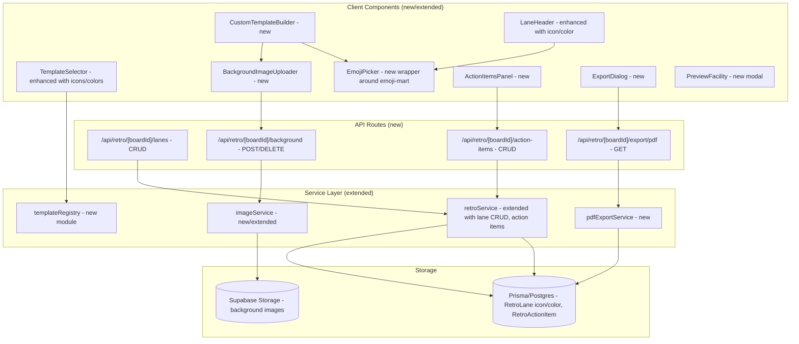

# Design Document: Retro Enhancements Phase 2B

## Overview

Phase 2B extends the interactive retro board delivered in Phase 2A with visual customisation, runtime column management, action items, export, and polish. The enhancements fall into four groups:

1. **Visual identity** — icon + color enrichment of lanes/templates, emoji picker, background images
2. **Template system** — enhanced built-in templates with metadata, custom template builder UI
3. **Board management** — runtime column add/edit/remove/reorder, action items CRUD
4. **Output & polish** — PDF export, facilitator preview facility, participant UI improvements

All work remains on the `phase-2-retro` branch behind `NEXT_PUBLIC_RETRO_ENABLED`. The development database is isolated at `jrcnttzdgipoalxxcnuh.supabase.co`.

### Design Decisions

| Decision | Rationale |
|----------|-----------|
| `@react-pdf/renderer` for PDF generation | JSX-based authoring, works server-side in Node/Next.js route handlers, no headless browser required, active maintenance |
| `emoji-mart` for emoji picker | Most popular React emoji picker, category-based browsing, keyword search, keyboard navigation, lazy-loadable data |
| Supabase Storage for background images | Already configured for the project (poll background images), consistent auth, CDN caching |
| Template registry stays in-code (not DB) | Built-in templates are static config; no need for a `Template` table until user-saved templates in Phase 2C |
| Runtime column changes persist to RetroLane rows only | Template definitions remain immutable; each board instance owns its lanes |
| RetroActionItem model already in schema | Defined in 2A for schema stability; 2B populates it via new service methods and routes |

## Architecture

Phase 2B extends the existing retro module without altering the core architecture. New components plug into the same service/route/component layers:



## Components and Interfaces

### Template Registry

A new module (`lib/retro/templateRegistry.ts`) replaces the hardcoded `TEMPLATE_LANES` in retroService with a richer data structure:

```ts
export interface TemplateColumnDef {
  title: string;
  icon: string;      // emoji character, e.g. "🚀"
  color: string;     // CSS color, e.g. "#4CAF50"
}

export interface RetroTemplateDefinition {
  id: string;                    // "start_stop_continue" | "4ls" | "mad_sad_glad" | "sailboat"
  name: string;                  // Human-readable display name
  columns: TemplateColumnDef[];  // Ordered column definitions
}

// Built-in templates
export const BUILT_IN_TEMPLATES: RetroTemplateDefinition[] = [
  {
    id: 'start_stop_continue',
    name: 'Start / Stop / Continue',
    columns: [
      { title: 'Start', icon: '🚀', color: '#4CAF50' },
      { title: 'Stop', icon: '🛑', color: '#F44336' },
      { title: 'Continue', icon: '✅', color: '#2196F3' },
    ],
  },
  {
    id: '4ls',
    name: '4Ls',
    columns: [
      { title: 'Liked', icon: '❤️', color: '#E91E63' },
      { title: 'Learned', icon: '📚', color: '#9C27B0' },
      { title: 'Lacked', icon: '🕳️', color: '#FF9800' },
      { title: 'Longed For', icon: '⭐', color: '#FFC107' },
    ],
  },
  {
    id: 'mad_sad_glad',
    name: 'Mad / Sad / Glad',
    columns: [
      { title: 'Mad', icon: '😡', color: '#F44336' },
      { title: 'Sad', icon: '😢', color: '#3F51B5' },
      { title: 'Glad', icon: '😊', color: '#4CAF50' },
    ],
  },
  {
    id: 'sailboat',
    name: 'Sailboat',
    columns: [
      { title: 'Wind (propelling us)', icon: '💨', color: '#03A9F4' },
      { title: 'Anchor (holding us back)', icon: '⚓', color: '#795548' },
      { title: 'Rocks (risks ahead)', icon: '🪨', color: '#9E9E9E' },
      { title: 'Island (our goal)', icon: '🏝️', color: '#FFEB3B' },
    ],
  },
];

export function getTemplateById(id: string): RetroTemplateDefinition | undefined;
export function getAllTemplates(): RetroTemplateDefinition[];
```

### Extended RetroService Interface

New methods added to the existing `RetroService` interface:

```ts
// --- Lane Management (Runtime Column Modification) ---

export interface CreateLaneInput {
  title: string;
  icon?: string;
  color?: string;
}

export interface UpdateLaneInput {
  title?: string;
  icon?: string | null;   // null to clear
  color?: string | null;  // null to clear
}

export interface ReorderLanesInput {
  laneIds: string[];  // ordered array of lane IDs representing new displayOrder
}

interface RetroService {
  // ... existing methods ...

  // Lane CRUD
  addLane(boardId: string, input: CreateLaneInput): Promise<RetroLane>;
  updateLane(laneId: string, input: UpdateLaneInput): Promise<RetroLane>;
  deleteLane(laneId: string): Promise<void>;
  reorderLanes(boardId: string, input: ReorderLanesInput): Promise<void>;

  // Action Items
  addActionItem(boardId: string, input: CreateActionItemInput): Promise<RetroActionItem>;
  updateActionItem(itemId: string, input: UpdateActionItemInput): Promise<RetroActionItem>;
  deleteActionItem(itemId: string): Promise<void>;
  getActionItems(boardId: string): Promise<RetroActionItem[]>;

  // PDF Export
  exportBoardPdf(boardId: string): Promise<Buffer>;
}

export interface CreateActionItemInput {
  text: string;          // 1–500 chars
  owner?: string;        // 0–100 chars, nullable
  dueDate?: string;      // ISO date string, nullable
}

export interface UpdateActionItemInput {
  text?: string;
  owner?: string | null;
  dueDate?: string | null;
}
```

### Extended BoardLaneView

The existing `BoardLaneView` interface gains `icon` and `color`:

```ts
export interface BoardLaneView {
  id: string;
  title: string;
  displayOrder: number;
  position: unknown;
  icon: string | null;     // NEW — emoji character
  color: string | null;    // NEW — CSS color string
  cardCount: number;
  cards: BoardCardView[];
}
```

### New API Routes

| Route | Method | Purpose | Auth |
|-------|--------|---------|------|
| `/api/retro/[boardId]/lanes` | POST | Add a lane | Facilitator |
| `/api/retro/[boardId]/lanes` | PATCH | Reorder lanes (body: `{ laneIds: string[] }`) | Facilitator |
| `/api/retro/[boardId]/lanes/[laneId]` | PATCH | Update lane title/icon/color | Facilitator |
| `/api/retro/[boardId]/lanes/[laneId]` | DELETE | Remove lane (with confirmation enforced client-side) | Facilitator |
| `/api/retro/[boardId]/action-items` | GET | List action items | Facilitator + participants (closed phase) |
| `/api/retro/[boardId]/action-items` | POST | Create action item | Facilitator (vote/closed phase) |
| `/api/retro/[boardId]/action-items/[itemId]` | PATCH | Update action item | Facilitator |
| `/api/retro/[boardId]/action-items/[itemId]` | DELETE | Delete action item | Facilitator |
| `/api/retro/[boardId]/export/pdf` | GET | Generate and download styled PDF | Facilitator |
| `/api/retro/[boardId]/background` | POST | Upload background image | Facilitator |
| `/api/retro/[boardId]/background` | DELETE | Remove background image | Facilitator |

### Emoji Picker Component

A thin wrapper around `emoji-mart` providing:

```tsx
interface EmojiPickerProps {
  onSelect: (emoji: string) => void;
  onClose: () => void;
  /** Anchor element ref for positioning */
  anchorEl?: HTMLElement | null;
}

// Usage: <EmojiPicker onSelect={(e) => setIcon(e)} onClose={() => setOpen(false)} />
```

Features:
- Category tabs (smileys, objects, symbols, nature, etc.)
- Keyword search input
- Full keyboard navigation (arrow keys, Enter to select, Escape to close)
- Lazy-loaded emoji data (split from main bundle)
- `aria-label` on each emoji option for screen reader accessibility

### Preview Facility Component

```tsx
interface PreviewFacilityProps {
  board: BoardView;
  isOpen: boolean;
  onClose: () => void;
}

// Renders the participant view in a modal overlay.
// - Applies anonymity rules (hides author names)
// - Reflects current phase display rules
// - All interactive controls (vote buttons, card add) are disabled
// - Escape key or close button dismisses without state change
```

### PDF Export Service

```ts
// lib/retro/pdfExportService.ts
import { renderToBuffer } from '@react-pdf/renderer';

export interface PdfExportData {
  boardTitle: string;
  template: string;
  lanes: Array<{
    title: string;
    icon: string | null;
    color: string | null;
    cards: Array<{ text: string; authorName: string; voteCount: number }>;
  }>;
  actionItems: Array<{ text: string; owner: string | null; dueDate: string | null }>;
}

export async function generateRetroPdf(data: PdfExportData): Promise<Buffer>;
```

The PDF document structure:
1. Header — SprintPulse logo, board title, generation date
2. Per-lane sections — lane icon + title as section header (colored), cards sorted by vote count descending, showing text + vote count
3. Action Items section — table with columns: Action, Assignee, Due Date
4. Footer — "Generated by SprintPulse" branding

### Background Image Handling

```ts
// lib/retro/imageService.ts

export interface BackgroundUploadResult {
  url: string;           // Public URL from Supabase Storage
  storagePath: string;   // Path within the bucket for deletion
}

export interface BackgroundImageConfig {
  url: string;
  opacity: number;       // 0–100 percentage
  displayMode: 'cover' | 'contain';
}

export async function uploadBackgroundImage(
  boardId: string,
  file: Buffer,
  mimeType: string,
): Promise<BackgroundUploadResult>;

export async function deleteBackgroundImage(boardId: string): Promise<void>;
```

Processing pipeline:
1. Validate file type (JPEG, PNG, WebP only)
2. Resize to max 1920px on longest edge using `sharp`
3. Compress to max 2MB
4. Upload to Supabase Storage bucket `retro-backgrounds/{boardId}/{filename}`
5. Set cache headers: `Cache-Control: public, max-age=3600`
6. Return public URL

### Custom Template Builder Component

```tsx
interface CustomTemplateBuilderProps {
  onComplete: (config: CustomBoardConfig) => void;
  onCancel: () => void;
}

interface CustomBoardConfig {
  columns: Array<{ title: string; icon: string; color: string }>;
  background?: {
    file: File;
    opacity: number;
    displayMode: 'cover' | 'contain';
  };
}
```

Features:
- Start with 0 columns; add via "+ Add Column" button
- Each column row: title input, emoji picker trigger, color picker (swatch palette)
- Drag-and-drop column reordering (using `@dnd-kit/core`)
- Min 1 / max 8 column enforcement with disabled add/remove buttons
- Background image upload section with opacity slider and cover/contain toggle
- "Create Board" button enabled only when ≥1 column defined

## Data Models

### Schema Changes (Migration)

Two nullable columns added to `RetroLane`:

```prisma
model RetroLane {
  id           String  @id @default(uuid())
  boardId      String
  title        String  @db.VarChar(100)
  displayOrder Int
  position     Json?
  icon         String? @db.VarChar(10)   // NEW — emoji character (nullable for backward compat)
  color        String? @db.VarChar(30)   // NEW — CSS color string (nullable for backward compat)

  board        RetroBoard  @relation(fields: [boardId], references: [id])
  cards        RetroCard[]

  @@index([boardId])
}
```

### RetroBoard Background Storage

Background image metadata is stored in the `RetroBoard` model via a new nullable JSON field:

```prisma
model RetroBoard {
  id              String   @id @default(uuid())
  pollId          String   @unique
  template        String
  phase           String   @default("gather")
  votesPerUser    Int      @default(3)
  backgroundImage Json?    // NEW — { url, opacity, displayMode } | null
  createdAt       DateTime @default(now())
  updatedAt       DateTime @updatedAt

  poll   Poll          @relation(fields: [pollId], references: [id])
  lanes  RetroLane[]
  cards  RetroCard[]
  votes  RetroVote[]

  @@index([pollId])
}
```

The `backgroundImage` JSON shape:

```ts
interface BackgroundImageMeta {
  url: string;
  storagePath: string;
  opacity: number;       // 0–100
  displayMode: 'cover' | 'contain';
}
```

### RetroActionItem (already in schema — no migration needed)

The existing `RetroActionItem` model is sufficient. Phase 2B populates it via new service methods:

```prisma
model RetroActionItem {
  id        String    @id @default(uuid())
  boardId   String
  text      String    @db.Text
  owner     String?   @db.VarChar(100)
  dueDate   DateTime?
  createdAt DateTime  @default(now())

  @@index([boardId])
}
```

### Migration Summary

| Change | Type | Risk |
|--------|------|------|
| Add `RetroLane.icon` (nullable VarChar(10)) | Additive column | Zero — nullable, no backfill |
| Add `RetroLane.color` (nullable VarChar(30)) | Additive column | Zero — nullable, no backfill |
| Add `RetroBoard.backgroundImage` (nullable Json) | Additive column | Zero — nullable, no backfill |
| RetroActionItem already exists | No change | None |

All changes are additive nullable columns requiring no data migration. Existing Phase 2A boards continue working with null icon/color values.


## Correctness Properties

*A property is a characteristic or behavior that should hold true across all valid executions of a system — essentially, a formal statement about what the system should do. Properties serve as the bridge between human-readable specifications and machine-verifiable correctness guarantees.*

### Property 1: Template structure completeness

*For any* template in the built-in template registry, it SHALL have a non-empty `name`, a non-empty `id`, and at least one column definition where each column has a non-empty `title`, a non-empty `icon` (emoji string), and a non-empty `color` (CSS color string).

**Validates: Requirements 1.1, 1.2**

### Property 2: Template-to-lane creation round-trip

*For any* built-in template selected during board creation, the resulting RetroLane records SHALL have `icon` and `color` values matching the corresponding column definitions in the template, preserving both the values and the display order.

**Validates: Requirements 1.4, 2.4**

### Property 3: Lane header renders icon and title together

*For any* lane view with a non-null `icon`, the rendered lane header output SHALL contain both the icon character and the lane title text, and SHALL include an accessible text label (via `aria-label` or visible text) conveying the icon meaning.

**Validates: Requirements 3.1, 3.3, 10.1, 11.1, 11.2**

### Property 4: Lane count minimum enforcement

*For any* board with exactly 1 lane, attempting to delete that lane SHALL fail with a validation error, ensuring the board always has at least 1 lane.

**Validates: Requirements 5.3, 6.7**

### Property 5: Lane count maximum enforcement

*For any* board with exactly 8 lanes, attempting to add another lane SHALL fail with a validation error, ensuring the board never exceeds 8 lanes.

**Validates: Requirements 5.4, 6.8**

### Property 6: Image processing output bounds

*For any* uploaded image regardless of input dimensions or file size, the image processing pipeline SHALL produce output with file size ≤ 2MB and longest edge ≤ 1920px.

**Validates: Requirements 5.10, 12.1**

### Property 7: Add lane grows lane count

*For any* board with fewer than 8 lanes, calling addLane SHALL increase the board's lane count by exactly 1 and the new lane SHALL appear in the board's lane list.

**Validates: Requirements 6.2**

### Property 8: Lane update persistence round-trip

*For any* existing lane and any valid update payload (title, icon, and/or color), after calling updateLane, reading the board back via getBoard SHALL return the lane with the updated values.

**Validates: Requirements 6.3, 13.4**

### Property 9: Lane deletion cascades to cards

*For any* lane containing N cards (where N ≥ 0), after calling deleteLane, neither the lane record nor any of its associated card records SHALL exist in the database.

**Validates: Requirements 6.5**

### Property 10: Lane reorder preserves correct display order

*For any* valid permutation of a board's lane IDs passed to reorderLanes, reading the board back SHALL return lanes with `displayOrder` values matching the input array index positions.

**Validates: Requirements 6.6**

### Property 11: Board instance isolation

*For any* two boards created from the same template, modifying lanes (add, edit, remove, reorder) on board A SHALL leave board B's lanes completely unchanged, and the template registry SHALL remain unmodified.

**Validates: Requirements 6.9, 13.1, 13.2, 13.3**

### Property 12: Action item phase gate

*For any* board in phase "vote" or "closed", addActionItem with valid input SHALL succeed. *For any* board in phase "gather", addActionItem SHALL fail with a phase error.

**Validates: Requirements 7.1**

### Property 13: Action item text validation

*For any* string input, addActionItem SHALL accept it if and only if the trimmed text length is between 1 and 500 characters (inclusive). Strings that are empty, whitespace-only, or exceed 500 characters after trimming SHALL be rejected.

**Validates: Requirements 7.2**

### Property 14: Action item owner length validation

*For any* owner string provided to addActionItem, the system SHALL accept it if and only if its length is at most 100 characters. Strings exceeding 100 characters SHALL be rejected.

**Validates: Requirements 7.3**

### Property 15: PDF content completeness

*For any* board with lanes, cards, and action items, the generated PDF document SHALL contain all lane titles (including icons), all card texts, vote counts for each card, and all action item texts with their assignees and due dates.

**Validates: Requirements 8.2, 8.4, 8.6**

### Property 16: PDF card ordering by votes

*For any* lane containing multiple cards with different vote counts, the PDF SHALL list those cards in descending vote count order.

**Validates: Requirements 8.5**

## Error Handling

| Scenario | HTTP Status | Error Code | Client Behavior |
|----------|-------------|------------|-----------------|
| Feature flag off | 404 | — | Route appears nonexistent |
| Add lane when board has 8 lanes | 400 | `LANE_LIMIT_EXCEEDED` | Disable "+ Add Column" button |
| Delete last lane on board | 400 | `MIN_LANES_REQUIRED` | Disable delete on last lane |
| Lane title empty or > 100 chars | 400 | `VALIDATION_ERROR` | Show field-level validation |
| Action item created in gather phase | 409 | `WRONG_PHASE` | Show phase requirement message |
| Action item text empty or > 500 chars | 400 | `VALIDATION_ERROR` | Show field-level validation |
| Action item owner > 100 chars | 400 | `VALIDATION_ERROR` | Show field-level validation |
| Background image > 10MB upload | 400 | `FILE_TOO_LARGE` | Show size limit message |
| Background image invalid type | 400 | `INVALID_FILE_TYPE` | Show accepted types message |
| Background image upload/storage failure | 500 | `UPLOAD_FAILED` | Show generic retry message |
| PDF generation failure | 500 | `EXPORT_FAILED` | Show generic retry message |
| Lane not found (stale reference) | 404 | `NOT_FOUND` | Re-sync board state |
| Action item not found | 404 | `NOT_FOUND` | Re-sync action items |
| Non-facilitator attempts lane/action mutation | 403 | `FORBIDDEN` | No mutation controls rendered for participants |
| Background image fails to load (client) | — | — | Render plain background silently |

### Error Handling Patterns

- **Optimistic rollback**: Lane add/edit/remove actions are applied optimistically on the client. On error response, the client reverts to the last-known-good state from the next poll cycle.
- **Graceful degradation**: Background images that fail to load render a plain background without surfacing an error to participants (Requirement 12.4).
- **Phase-aware UI**: The client disables action item creation controls during gather phase, preventing most phase-gate errors before they reach the server.

## Testing Strategy

### Property-Based Tests (fast-check + Vitest)

The following correctness properties are tested via property-based testing with a minimum of 100 iterations per property:

| Property | Test Target | Key Generators |
|----------|-------------|----------------|
| 1: Template structure | `templateRegistry` module | Iterate all built-in templates |
| 2: Template-to-lane round-trip | `retroService.createBoard` | Random template selection |
| 3: Lane header rendering | `LaneHeader` component | Random lane data with/without icon/color |
| 4: Min lane enforcement | `retroService.deleteLane` | Boards with 1 lane |
| 5: Max lane enforcement | `retroService.addLane` | Boards with 8 lanes |
| 6: Image processing bounds | `imageService.processImage` | Random image dimensions/sizes |
| 7: Add lane count | `retroService.addLane` | Boards with 1–7 lanes |
| 8: Lane update round-trip | `retroService.updateLane` + `getBoard` | Random title/icon/color values |
| 9: Lane delete cascade | `retroService.deleteLane` | Lanes with 0–N cards |
| 10: Reorder correctness | `retroService.reorderLanes` | Random permutations of lane IDs |
| 11: Instance isolation | Two boards from same template | Random modifications on board A |
| 12: Action item phase gate | `retroService.addActionItem` | All three phases × valid input |
| 13: Action item text validation | `retroService.addActionItem` | Random strings (empty, whitespace, 1–500, >500) |
| 14: Owner length validation | `retroService.addActionItem` | Random strings (0–100, >100) |
| 15: PDF content completeness | `pdfExportService.generateRetroPdf` | Random board data with lanes/cards/actions |
| 16: PDF card ordering | `pdfExportService.generateRetroPdf` | Lanes with randomly-ordered cards |

**Configuration:**
- Library: `fast-check` (already in project)
- Runner: Vitest
- Min iterations: 100 per property
- Tag format: `Feature: retro-enhancements-phase-2b, Property {N}: {title}`

### Unit Tests (Example-Based)

| Area | Key Test Cases |
|------|---------------|
| Template selector UI | All built-in templates + "Create Your Own" render correctly |
| Emoji picker wrapper | onSelect callback fires with correct emoji string |
| Custom template builder | Start with 0 columns, add/remove/reorder flow |
| Preview facility | Read-only mode (no interactive controls), anonymity matches participant view |
| Phase indicator | Shows correct phase text for gather/vote/closed |
| Backward compatibility | Lanes with null icon/color render title-only |
| PDF branding | Logo and color scheme present in output |
| Export dialog | Both PDF and JSON options rendered |
| Mobile layout | Horizontal scroll for >3 columns |

### Integration Tests

| Area | Test Cases |
|------|------------|
| Lane CRUD API routes | Full lifecycle: create → update → reorder → delete |
| Action items API routes | Create in vote/closed, edit, delete, list |
| Background image upload | Upload → storage → retrieve with cache headers |
| PDF export route | Generate and verify PDF response headers and magic bytes |
| Phase 2A backward compat | All existing Phase 2A tests pass unchanged |
| Supabase Storage | Upload, public URL generation, deletion |

### Accessibility Testing

- Verify `aria-label` on all lane icons
- Verify keyboard navigation in emoji picker
- Verify ARIA live regions on lane changes
- Verify color contrast of template colors against standard backgrounds
- Manual testing with screen reader for preview facility

